

  <picture><source media="(prefers-color-scheme: dark)" srcset="assets/hero-dark.svg">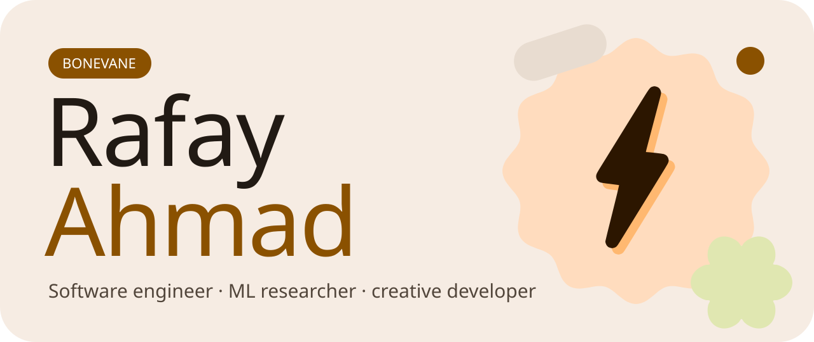</picture>

<a href="mailto:rahmad.atomic44@gmail.com"><picture><source media="(prefers-color-scheme: dark)" srcset="assets/link-email-dark.svg"></picture></a>
<a href="https://bonevane.dev"><picture><source media="(prefers-color-scheme: dark)" srcset="assets/link-portfolio-dark.svg"></picture></a>
<a href="https://linkedin.com/in/rafay-ahmad"><picture><source media="(prefers-color-scheme: dark)" srcset="assets/link-linkedin-dark.svg"></picture></a>
<a href="https://youtube.com/@bonevane"><picture><source media="(prefers-color-scheme: dark)" srcset="assets/link-youtube-dark.svg"></picture></a>
<a href="https://bonevane.itch.io"><picture><source media="(prefers-color-scheme: dark)" srcset="assets/link-itchio-dark.svg"></picture></a>
<a href="https://instagram.com/rafay_ahmad44"><picture><source media="(prefers-color-scheme: dark)" srcset="assets/link-instagram-dark.svg"></picture></a>
<a href="https://x.com/Bonevane_YT"><picture><source media="(prefers-color-scheme: dark)" srcset="assets/link-x-dark.svg"></picture></a>
<a href="https://discord.com/users/bonevane"><picture><source media="(prefers-color-scheme: dark)" srcset="assets/link-discord-dark.svg"></picture></a>

 

**Welcome to my space.**

I'm a software engineer from Pakistan that loves to build experimental stuff. Sometimes, I share what I do.

These days that mostly means teaching vision-language models to read Urdu, cramming AI onto cheap phones, and building whatever else catches my eye.

 

<picture><source media="(prefers-color-scheme: dark)" srcset="assets/section-what-dark.svg">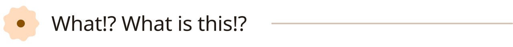</picture>

This is my GitHub profile. T'is a place where I share the kinds of things I tinker with: research code, web apps, games, 3D experiments, and the occasional thing that probably shouldn't work but does.

For a more curated version of my work, check out my portfolio site here:
👉 **[bonevane.dev](https://bonevane.dev)**

 

<picture><source media="(prefers-color-scheme: dark)" srcset="assets/section-now-dark.svg">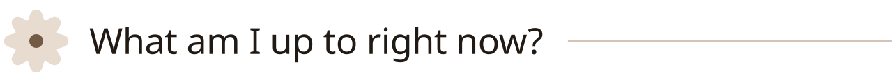</picture>

  <picture><source media="(prefers-color-scheme: dark)" srcset="assets/now-dark.svg">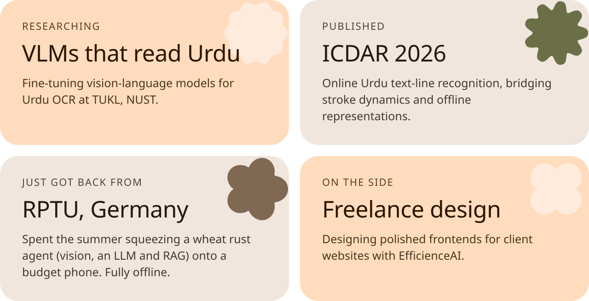</picture>

 

<picture><source media="(prefers-color-scheme: dark)" srcset="assets/section-proud-dark.svg">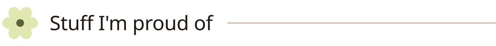</picture>

  <a href="https://github.com/Bonevane/Bridge"><picture><source media="(prefers-color-scheme: dark)" srcset="assets/card-bridge-dark.svg">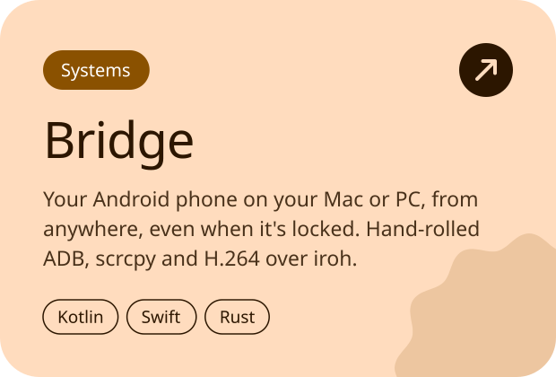</picture></a>
  <a href="https://github.com/dmunish/reach"><picture><source media="(prefers-color-scheme: dark)" srcset="assets/card-reach-dark.svg">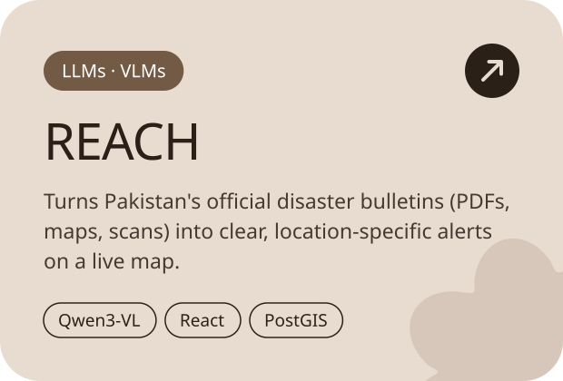</picture></a>

  <a href="https://github.com/Bonevane/Spillage-Search"><picture><source media="(prefers-color-scheme: dark)" srcset="assets/card-spillage-dark.svg">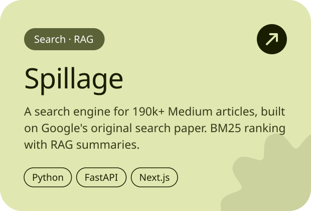</picture></a>
  <a href="https://github.com/Bonevane/F1-Reinforcement"><picture><source media="(prefers-color-scheme: dark)" srcset="assets/card-f1-dark.svg">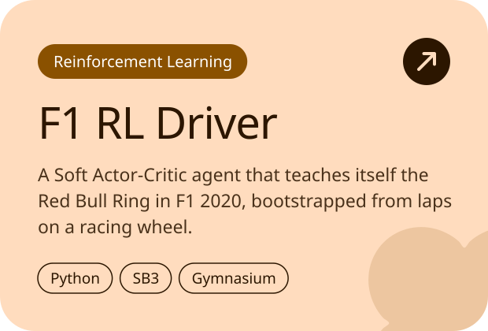</picture></a>

  <a href="https://github.com/Bonevane/ScalAR-Measurement"><picture><source media="(prefers-color-scheme: dark)" srcset="assets/card-scalar-dark.svg">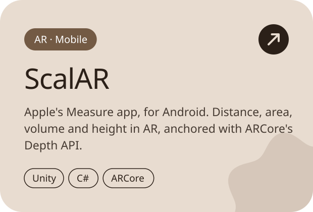</picture></a>
  <a href="https://github.com/Bonevane/Path-Tracer"><picture><source media="(prefers-color-scheme: dark)" srcset="assets/card-pathtracer-dark.svg">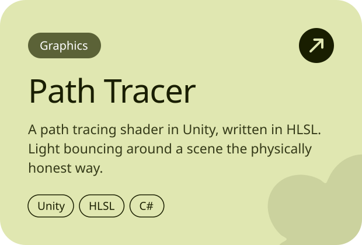</picture></a>

 

<picture><source media="(prefers-color-scheme: dark)" srcset="assets/section-find-dark.svg">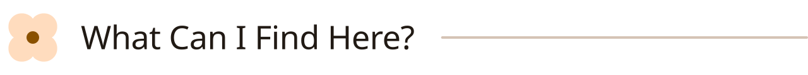</picture>

Well. You'll find a whole lot of stuff. But most of it can be classified into these categories:

  <picture><source media="(prefers-color-scheme: dark)" srcset="assets/find-dark.svg">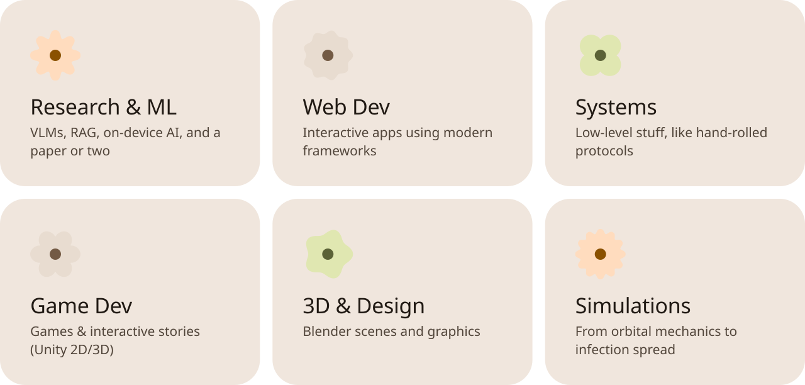</picture>

 

<picture><source media="(prefers-color-scheme: dark)" srcset="assets/section-stack-dark.svg">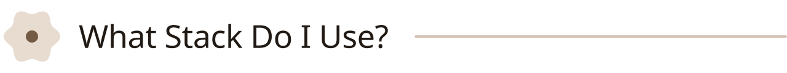</picture>

These are the main tools, frameworks, and languages I work with.
(Might be forgetting a few, but this covers most of them.)

  <picture><source media="(prefers-color-scheme: dark)" srcset="assets/stack-dark.svg">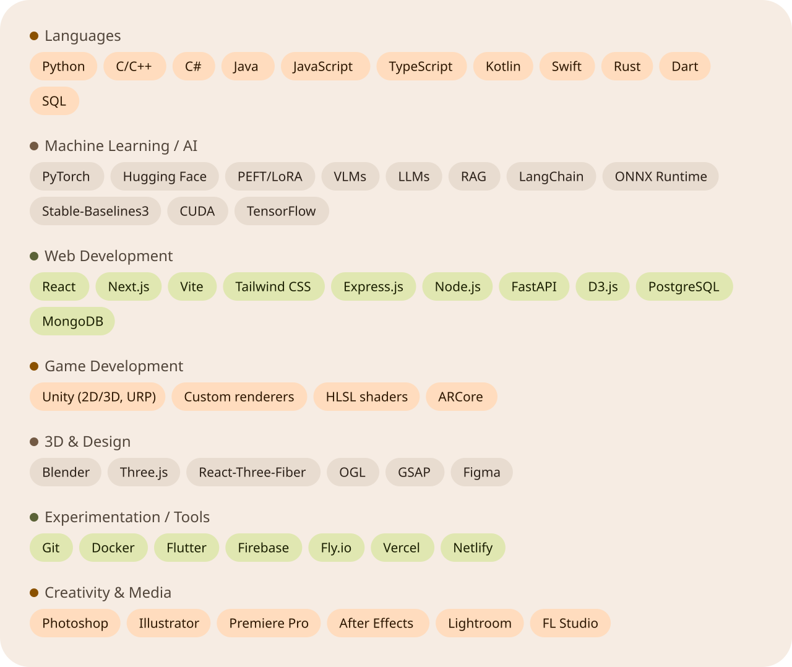</picture>

 

<picture><source media="(prefers-color-scheme: dark)" srcset="assets/section-stats-dark.svg"></picture>

  <picture><source media="(prefers-color-scheme: dark)" srcset="assets/stats-dark.svg">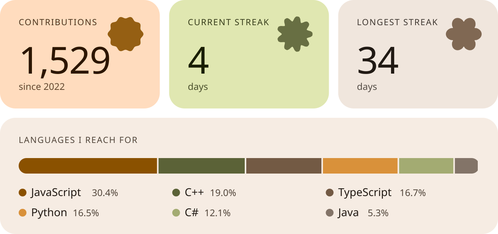</picture>

 

  <picture><source media="(prefers-color-scheme: dark)" srcset="assets/footer-dark.svg">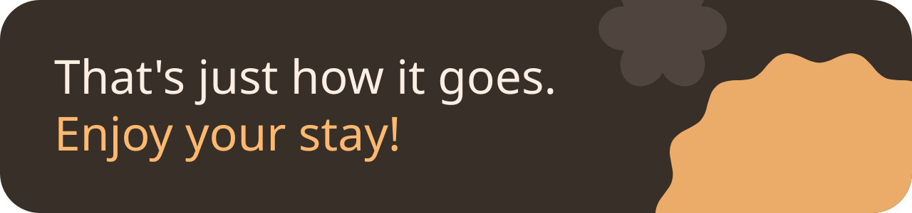</picture>

<!-- Paste your closing quote back in here -->
